# Moodify 🎵

Moodify is an Android app that turns your mood into music. Pick a mood with an emoji slider or a spin wheel, and Moodify pulls 5 real songs from the Spotify Web API, complete with album art.

Built in Kotlin with Android Views/XML.

<p align="center">
  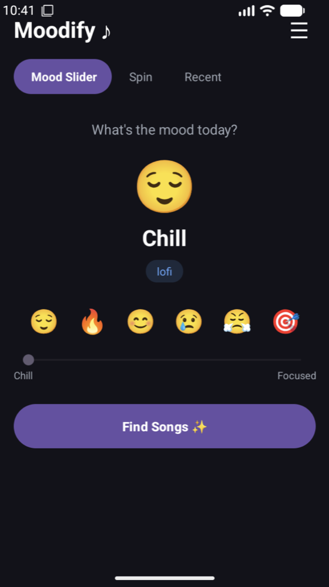
  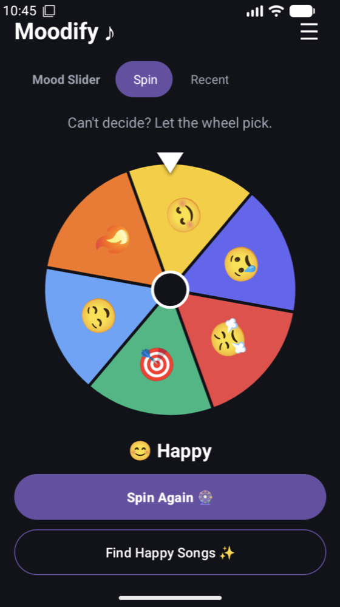
  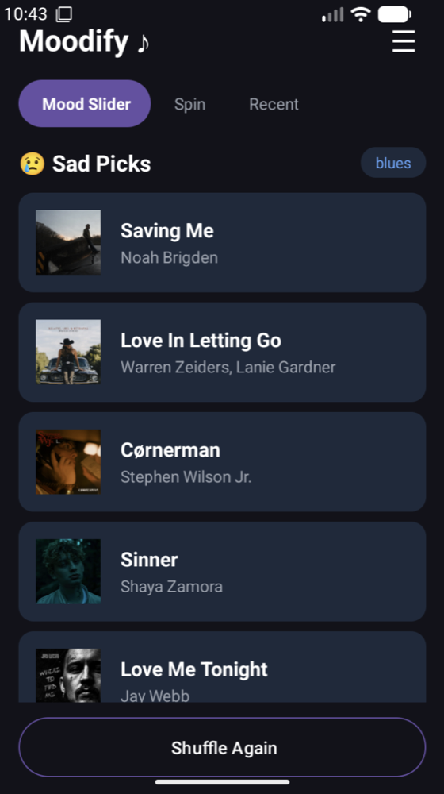
  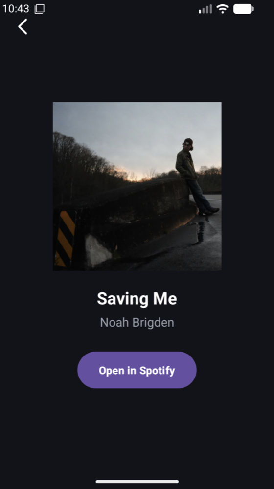
</p>

## Features

- **Mood Slider:** tap an emoji or drag the slider to choose one of 6 moods.
- **Find Songs:** gets 5 real tracks from Spotify for that mood's genre.
- **Shuffle Again:** searches from a random offset so each tap gives a new set.
- **Spin wheel:** a custom-drawn wheel spins to a random mood, then finds songs for it.
- **Recent:** your last 5 moods (no duplicates) are kept after the app closes. Tap one to get new songs for it.
- **Song detail:** shows the large album art, title and artist. **Open in Spotify** plays the track in the Spotify app, or in the browser if the app isn't installed.
- **Preferences:** choose a default mood (or Random) and whether explicit songs are allowed. Both are saved with SharedPreferences.
- **Onboarding:** a short first-launch setup that asks about explicit content and explains how the app works.
- **Help screen:** explains how to use the app and lists which genre each mood maps to.
- If Spotify can't be reached, the app shows a clear message instead of crashing.

## Along the Way

How Moodify changed from the first build to 1.0.

**1. First build (Sep 21, 2026):** the Mood Slider and a song detail screen, using placeholder songs and a plain white detail page.

| Mood Slider | Placeholder songs | Song detail |
|:---:|:---:|:---:|
| 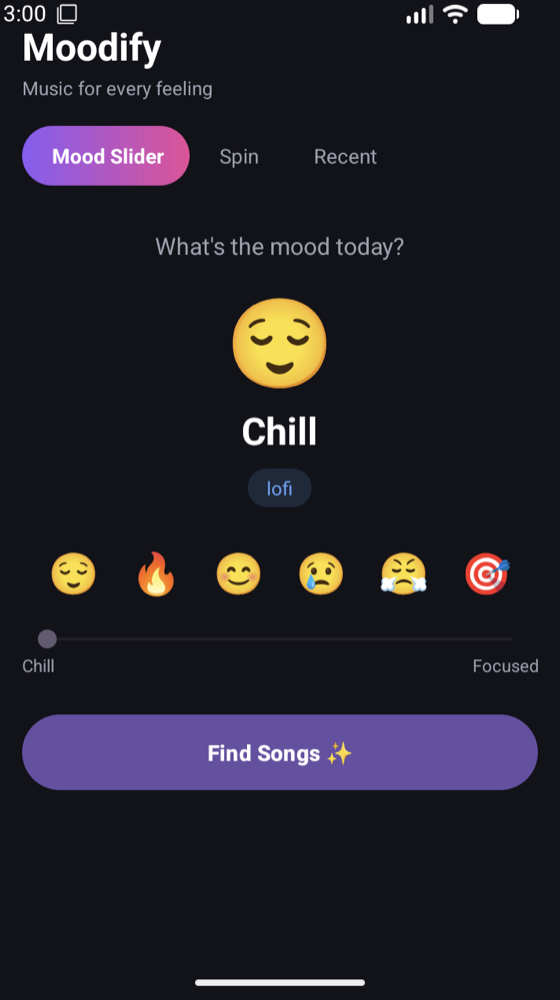 | 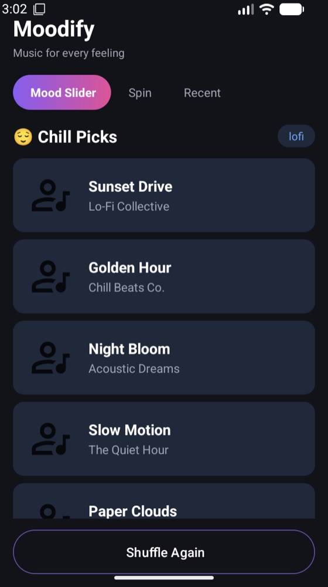 | 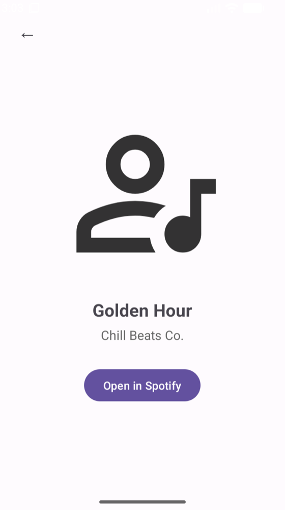 |

**2. Preferences and Help (Sep 28):** a ☰ menu (still the default Android dropdown) that opens new Preferences and Help screens.

| Menu | Preferences | Help |
|:---:|:---:|:---:|
| 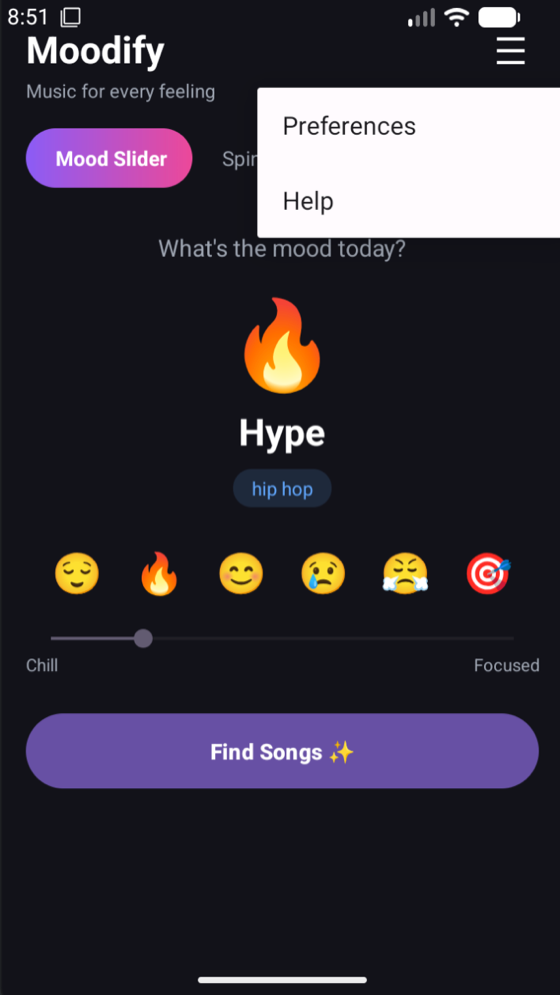 | 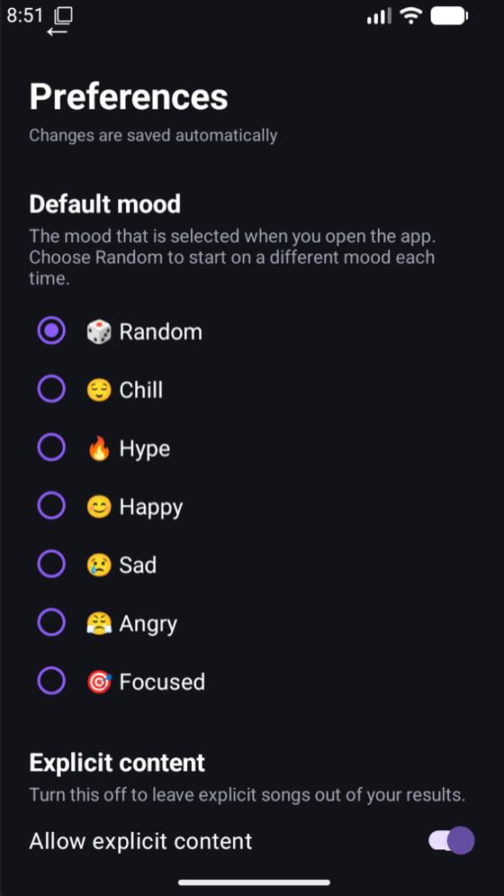 | 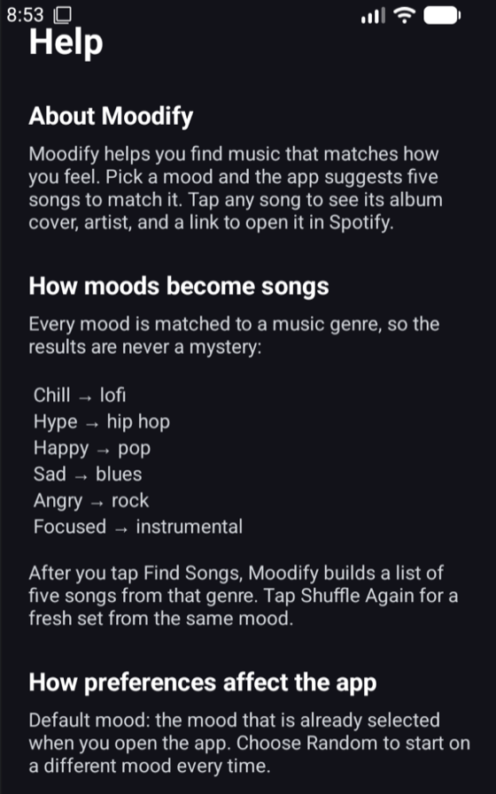 |

**3. Onboarding and Recent (Oct 5):** a first-launch setup with a round logo, a Recent tab and the menu as gradient bubbles.

| Welcome | Recent | Menu |
|:---:|:---:|:---:|
| 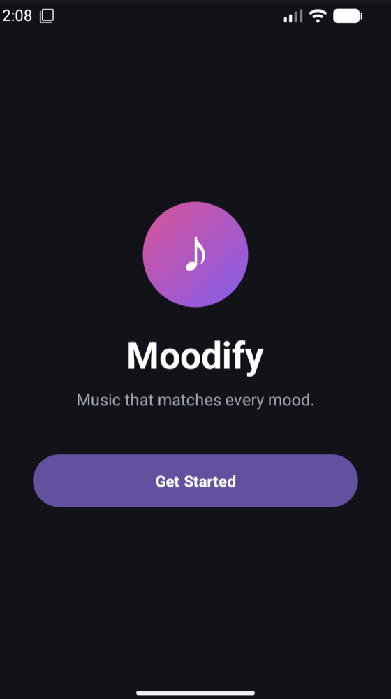 | 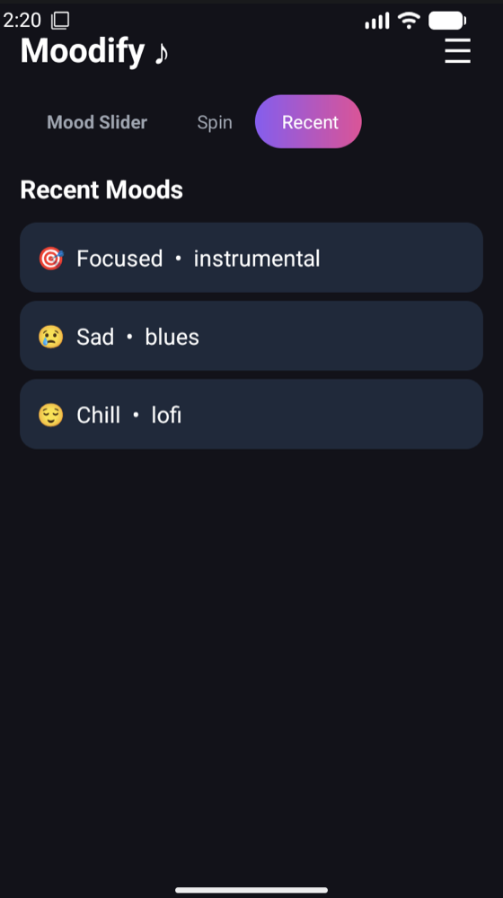 | 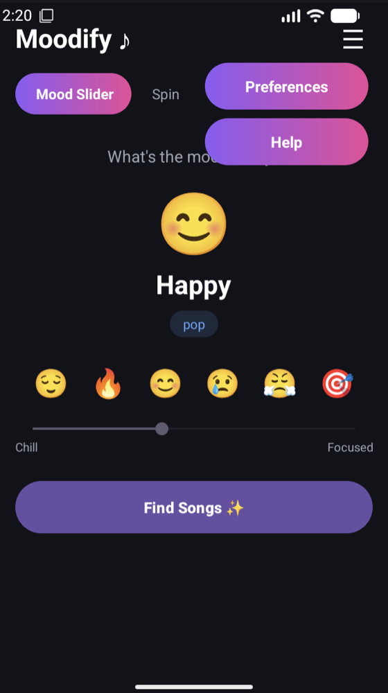 |

**4. Real Spotify songs (Oct 7):** real tracks and album art from the Spotify API, a dark detail page, and Open in Spotify going to the real track.

| Spotify results | Song detail | Open in Spotify |
|:---:|:---:|:---:|
| 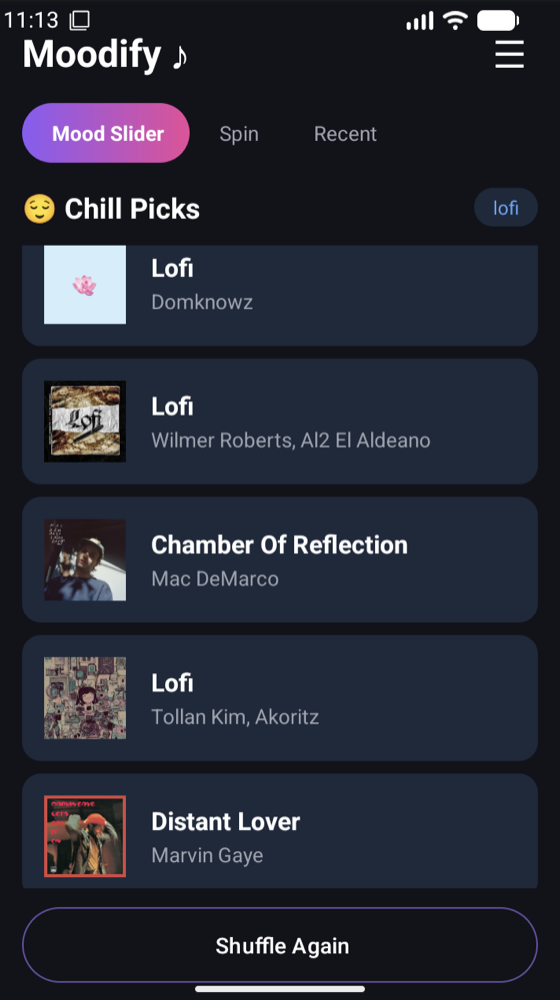 | 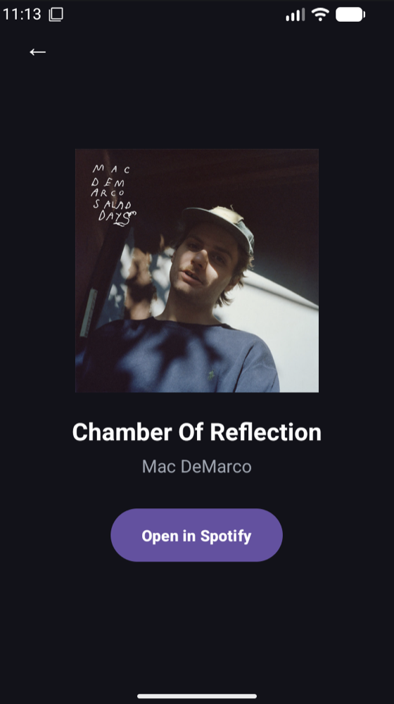 | 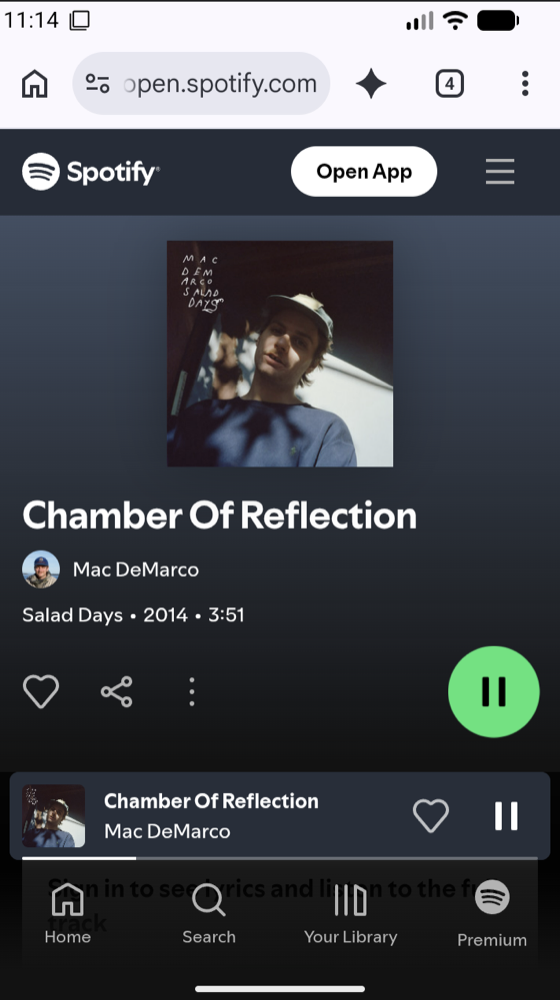 |

**5. Moodify 1.0 (Oct 8):** the Spin wheel, a new app-icon logo, chevron back buttons, and one purple across the tabs and menu.

| New logo | Spin wheel | Menu |
|:---:|:---:|:---:|
| 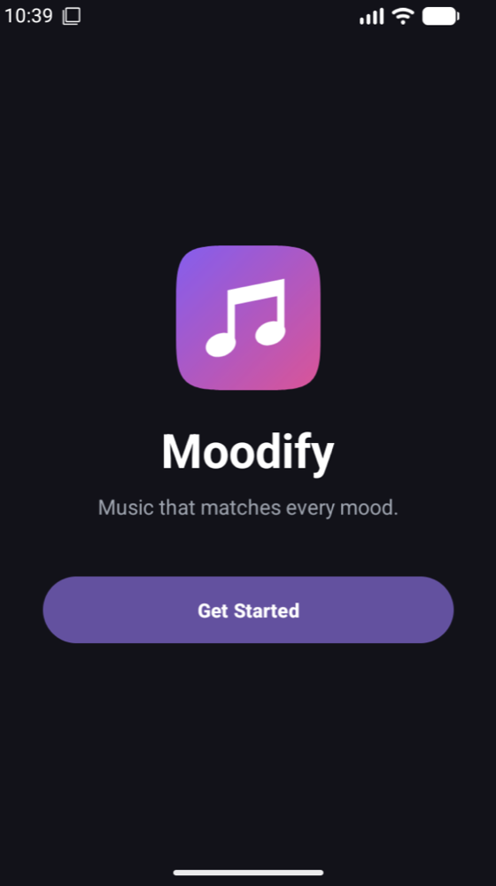 |  | 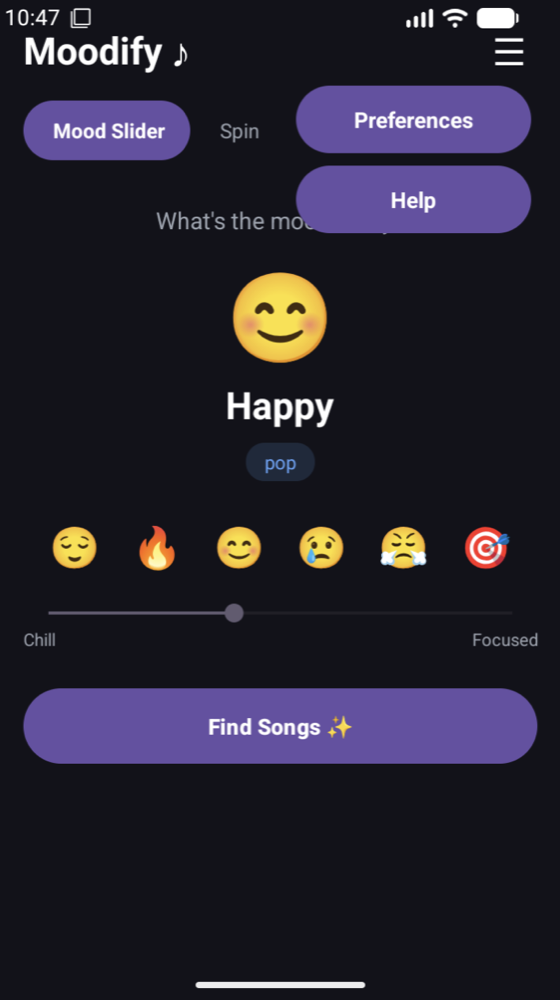 |

## Mood → Genre

| Mood | Genre |
|------|-------|
| 😌 Chill | lofi |
| 🔥 Hype | hip hop |
| 😊 Happy | pop |
| 😢 Sad | blues |
| 😤 Angry | rock |
| 🎯 Focused | instrumental |

## Tech Stack

- **Kotlin**, Android Views/XML, Material Components
- **Spotify Web API:** Client Credentials auth + `/v1/search`
- **Glide** for album art
- **RecyclerView** for song lists
- **SharedPreferences** for settings and mood history
- Min SDK 24, target SDK 37

## Getting Started

1. Clone the repo and open it in **Android Studio**.
2. Create an app in the [Spotify Developer Dashboard](https://developer.spotify.com/dashboard) and copy its Client ID and Client Secret.
3. Add them to `local.properties` in the project root (no quotes or spaces):
   ```properties
   SPOTIFY_CLIENT_ID=your_client_id
   SPOTIFY_CLIENT_SECRET=your_client_secret
   ```
4. Sync Gradle and run the app on an emulator or device.

`local.properties` is git-ignored, so your keys stay out of the repo. Gradle reads them into `BuildConfig` when the app builds.

> **Note:** Spotify now requires the developer app owner to have Spotify Premium for Web API access. Moodify uses Search only because Spotify locked the `/recommendations` endpoint in Nov 2024.

> **Security note:** Moodify uses the Client Credentials flow inside the app, so the secret is compiled into the APK and anyone who has the APK can extract it. That's fine for a demo or personal use. A production app should get its tokens from a backend server.

## Project Structure

```
app/src/main/java/com/example/moodify/
├── MainActivity.kt        # Tabs: Mood Slider, Recent, Spin
├── MoodWheelView.kt       # Custom spin-wheel View
├── SecondaryActivity.kt   # Song detail + Open in Spotify
├── Preferencesactivity.kt # Default mood + explicit filter
├── Helpactivity.kt        # Help screen
├── Onboardingfragment.kt  # First-launch setup
├── SpotifyApi.kt          # Token + Search requests
├── SongAdapter.kt         # RecyclerView adapter
├── Mood.kt / Song.kt      # Data classes
```

## Author

**Camdyn Newman**
